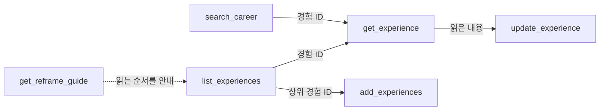

# Career MCP

[English](README.md)

경력 사항을 구조화된 데이터로 저장하고, 여러 AI 앱에서 꺼내 쓰게 해 주는 MCP 서버예요.
채용 공고를 주면 저장된 경력을 근거로 그 공고에 맞춰 경험을 다시 읽어 줘요(리프레이밍).

- 한 번 넣은 경력을 연결한 앱 어디서나 써요. 앱을 바꿀 때마다 경력을 다시 설명하지 않아도 돼요.
- 서버는 LLM을 호출하지 않아요. 판단은 지금 쓰는 AI 앱이 하고, 서버는 데이터와 지침만 줘요.
- 서버 하나에 주인 한 명이에요. 각자 자기 Vercel에 띄우니 경력 데이터는 내 DB에만 있어요.

## 할 수 있는 것

**읽기**

| tool | 하는 일 |
|---|---|
| `list_experiences` | 전체 경험 목록(ID, 상위 경험, 제목) |
| `get_experience` | 경험 하나의 제목, 하위 경험, 내용 |
| `search_career` | 정확한 단어가 들어간 줄 찾기 |
| `get_reframe_guide` | 리프레이밍 지침. 공고 분석을 부탁하면 AI가 알아서 불러요 |

**쓰기**

| tool | 하는 일 |
|---|---|
| `add_experiences` | 경험 하나 또는 여러 개 추가. 하나라도 실패하면 전부 취소 |
| `update_experience` | 제목과 상위 경험 변경, 내용 덧붙이기(`append`) 또는 전체 교체(`body`) |



- 경험 하나는 제목과 마크다운 본문 하나로 이뤄져요. 본문은 한 줄에 한 가지씩 적어요.
- `확인 필요`(또는 `[unconfirmed]`)가 적힌 줄은 근거로 쓰지 않아요. 확인되면 그 표시만 지워요.
- 쓰기 tool은 바꿀 내용을 먼저 보여 주고 동의를 받은 뒤에만 불러요.

## 내 서버 띄우기

준비물: GitHub, Vercel 계정(무료 플랜으로 충분해요)

1. 이 레포를 fork 하고 Vercel에서 Import 해요.
2. Vercel 프로젝트의 **Storage**에서 Neon(Postgres)을 연결해요. `DATABASE_URL`이 자동으로 들어가요.
3. 환경변수를 넣어요.

   | 이름 | 값 |
   |---|---|
   | `BETTER_AUTH_SECRET` | 필수. `openssl rand -base64 32`로 만든 값 |
   | `OWNER_EMAIL` | 권장. 내 이메일. 다른 사람이 먼저 가입하는 것을 막아요 |
   | `APP_URL` | 선택. 비우면 Vercel 프로덕션 주소를 써요 |

4. 다시 배포해요. 빌드할 때 DB 테이블이 자동으로 만들어져요.
5. `https://<내 주소>/login`에서 소유자 계정을 만들어요. 계정은 하나만 만들 수 있어요.

연결할 주소는 `https://<내 주소>/api/mcp`예요.

## AI 앱에 연결하기

| 앱 | 연결 방법 |
|---|---|
| Claude (웹, 데스크톱, 모바일) | 설정 → 커넥터 → 커스텀 커넥터 추가 → 주소 입력 → 로그인 후 허용 |
| ChatGPT | 설정에서 개발자 모드를 켠 뒤 커넥터 만들기 → 주소 입력, 인증은 OAuth. 유료 요금제가 필요해요 |
| Notion | 설정 → 연결 → Add Custom MCP. 워크스페이스 관리자가 허용한 경우에만 보여요 |

Claude에서 직접 확인했어요. 다른 앱도 원격 MCP와 OAuth를 지원하면 같은 주소로 연결돼요. 메뉴 위치는 앱 업데이트에 따라 바뀔 수 있어요.

## 다음: 경력 넣기

연결했으면 경력부터 넣어요. 한 번 넣으면 계속 써요.

- **하나씩:** "지난 회사에서 결제 화면 개편을 맡았어. 기록해 줘"
- **한꺼번에:** 기존 이력서나 포트폴리오를 붙여 넣고 "내 경력으로 기록해 줘". 경험별로 나눈 결과를 먼저 보여 주고, 동의하면 저장해요.
- **마크다운 파일로:** `npm run import -- career.md` (`### A1. 제목` 형식의 제목과 `- ` 목록을 읽어요)

경력이 들어가면 채용 공고를 붙여 넣고 "이 공고 내 경험으로 봐 줘"라고 하면 돼요. 앱이 웹 페이지를 읽을 수 있으면 공고 링크를 줘도 돼요.

## 로컬 개발

```bash
npm install
cp .env.example .env.local   # BETTER_AUTH_SECRET만 채우면 돼요
npm run migrate              # DATABASE_URL이 비어 있으면 ./.pglite에 로컬 DB를 만들어요
npm run dev
node scripts/e2e-oauth.mjs   # OAuth 연결부터 tool 호출까지 자동 점검
```

Next.js 16, Better Auth(`@better-auth/mcp`), Vercel `mcp-handler`, Kysely, Neon Postgres로 만들었어요.

## 라이선스

MIT
