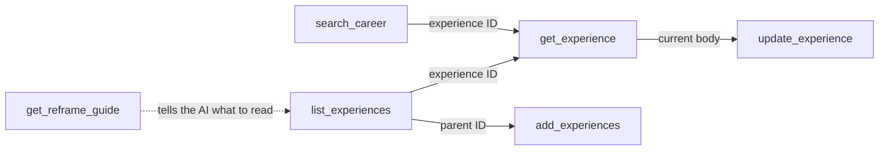

# Career MCP

[한국어](README.ko.md)

A personal MCP server that stores your career history as structured data and serves it to any AI app you connect.
Give it a job posting and it reframes your experience for that role, citing only what you have recorded.

- **Write once, use everywhere.** Claude, ChatGPT and other MCP clients all read the same record, so you stop re-explaining your career to every new chat.
- **No LLM on the server.** The AI app you already use does the reasoning. The server only stores data and hands out instructions.
- **One server, one owner.** Each person deploys their own copy to Vercel, so your career data stays in your own database.

## What it does

**Read**

| Tool | Purpose |
|---|---|
| `list_experiences` | List all experiences (ID, parent, title) |
| `get_experience` | Read one experience: title, children, body |
| `search_career` | Find lines containing an exact word |
| `get_reframe_guide` | Reframing instructions. The AI calls it on its own when you ask it to analyze a job posting |

**Write**

| Tool | Purpose |
|---|---|
| `add_experiences` | Add one or many experiences. All or nothing |
| `update_experience` | Rename, move under another parent, append lines (`append`) or replace the body (`body`) |



- An experience is a title plus a Markdown body, one point per line.
- Lines marked `[unconfirmed]` (or `확인 필요`) are never used as evidence. Once confirmed, only the marker is removed.
- Write tools are called only after the AI shows you the change and you agree.

## Deploy your own server

You need a GitHub account and a Vercel account (the free plan is enough).

1. Fork this repo and import it in Vercel.
2. In the Vercel project, open **Storage** and connect Neon (Postgres). `DATABASE_URL` is set for you.
3. Add environment variables:

   | Name | Value |
   |---|---|
   | `BETTER_AUTH_SECRET` | Required. Generate with `openssl rand -base64 32` |
   | `OWNER_EMAIL` | Recommended. Your email, so nobody else can claim the server first |
   | `APP_URL` | Optional. Defaults to the Vercel production URL |

4. Redeploy. Tables are created during the build.
5. Open `https://<your-domain>/login` and create the owner account. Only one account can exist.

Your connector URL is `https://<your-domain>/api/mcp`.

## Connect an AI app

| App | How |
|---|---|
| Claude (web, desktop, mobile) | Settings → Connectors → Add custom connector → paste the URL → sign in and allow |
| ChatGPT | Turn on developer mode in settings, create a connector with the URL and OAuth authentication. Requires a paid plan |
| Notion | Settings → Connections → Add Custom MCP. Visible only if your workspace admin allows it |

Tested with Claude. Other apps that support remote MCP with OAuth should connect the same way. Menu locations change as apps update.

## Next: add your career

Once connected, start by adding your career. You only do this once.

- **One at a time:** "At my last job I led the checkout page redesign. Record this."
- **All at once:** paste your resume or portfolio and say "Record this as my career." The AI shows how it split the text into experiences and saves only after you agree.
- **From a Markdown file:** `npm run import -- career.md` (reads `### A1. Title` headings and `- ` bullets)

Then paste a job posting and ask "How does my experience fit this role?" If the app can read web pages, a link works too.

## Current limitations

- Self-hosting requires deploying to Vercel, so it is aimed at developers for now.
- Tested with Claude only. Other MCP clients should work but have not been verified.

## Local development

```bash
npm install
cp .env.example .env.local   # only BETTER_AUTH_SECRET is required
npm run migrate              # without DATABASE_URL, creates a local PGlite database in ./.pglite
npm run dev
node scripts/e2e-oauth.mjs   # end-to-end check from OAuth sign-in to a tool call
```

Built with Next.js 16, Better Auth (`@better-auth/mcp`), Vercel `mcp-handler`, Kysely and Neon Postgres.

## License

MIT
